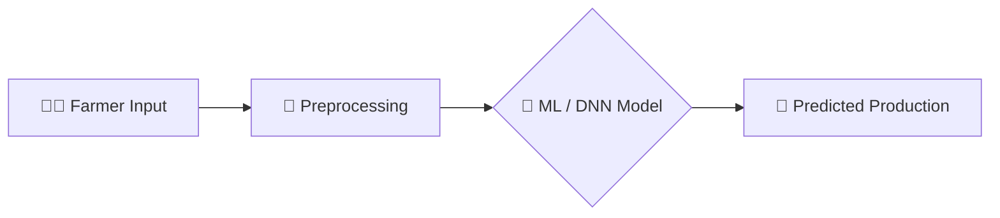

<div align="center">


<b><i>Smart Crop Production Prediction with ML & Deep Learning</i></b>


       

   
</div>

---

## 🌾 About the Project

**AgriPredict** is a machine-learning web application that analyses agricultural field data and predicts **crop production** from inputs such as state, district, season, crop and area. It combines a classical ML model with a **Deep Neural Network (DNN)** and serves predictions through a clean Flask web interface with user login and sign-up.

## ✨ Key Features

- 🔐 User **sign-up / login** before accessing predictions
- 📊 Trained on a real **crop production dataset** (`Crop Prediction dataset.csv`)
- 🧠 Dual models — `model.pkl` (ML) and `dnn_model.h5` (Keras DNN)
- ⚡ Instant prediction results on a dedicated result page
- 📓 Full EDA + training workflow in `crop_production.ipynb`

## 🧠 How It Works



## 🛠️ Tech Stack

| Layer | Technology |
|---|---|
| Language | Python 3 |
| Data & ML | Pandas · NumPy · scikit-learn |
| Notebook | Jupyter |
| Web App | Flask + Jinja2 templates |
| Frontend | HTML5 · CSS3 |
| Deep Learning | TensorFlow / Keras (DNN) |

## 📂 Project Structure

```text
agripredict_updated/
├── app.py                     # Flask application
├── crop_production.ipynb      # EDA + model training
├── Crop Prediction dataset.csv
├── model.pkl                  # ML model
├── dnn_model.h5               # Deep neural network
├── static/css/agri.css
└── templates/  (index, login, signup, prediction, result)
```

## 🚀 Getting Started

```bash
git clone https://github.com/PreciousBharath/AGRICULTURE-FIELD.git
cd "AGRICULTURE-FIELD/agripredict_updated-20260416T074421Z-3-001/agripredict_updated"
pip install flask pandas numpy scikit-learn tensorflow
python app.py
# open http://127.0.0.1:5000
```

## 🤝 Contributing

Contributions, issues and feature requests are welcome! Feel free to ⭐ star the repo and open a pull request.

## 👨‍💻 Author

<div align="center">

**Bharath** — Software Developer · Project Engineer · Technical Trainer

<a href="https://github.com/PreciousBharath"></a>
<a href="https://linkedin.com/in/connectbharath"></a>

### 🍔 EAT · 😴 SLEEP · 💻 CODE · 🔁 REPEAT

⭐ **If you found this project useful, give it a star!** ⭐


</div>
